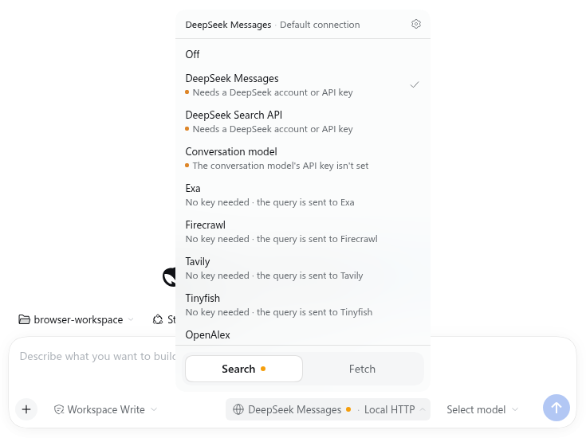
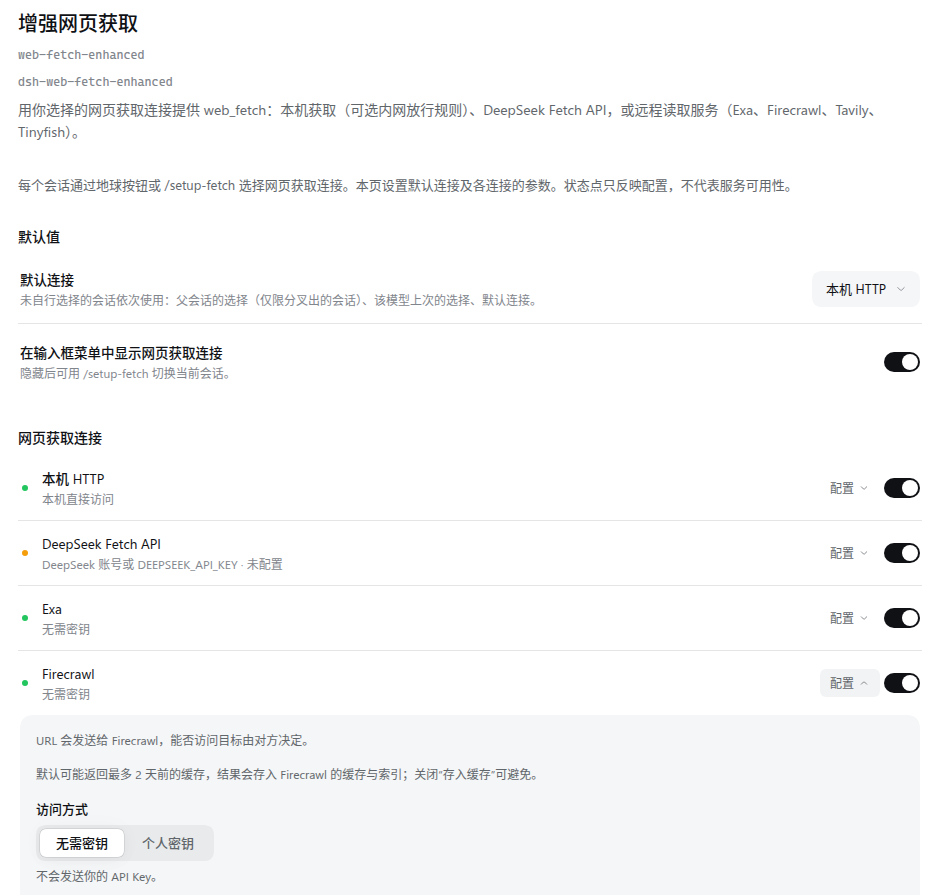
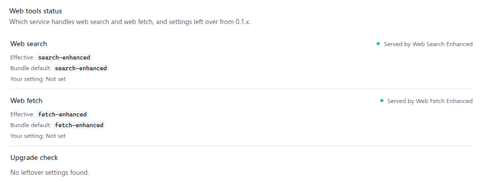

<div align="center">


# DSH Tool Web Enhanced

**为 DeepSeek Harness 的 `web_search` 与 `web_fetch` 提供可切换的后端，每个会话分别选择搜索与抓取连接。**

[](https://www.npmjs.com/package/dsh-tool-web-enhanced-profile)
[](https://github.com/Yurzi/dsh-tool-web-enhanced/actions/workflows/ci.yml)
[](LICENSE)
[](packages/profile/package.json)
[](packages/profile/package.json)

</div>

dsh-tool-web-enhanced 是 [DeepSeek Harness (DSH)](https://github.com/deepseek-ai/deepseek-harness) 的一个组合包（bundle）。安装后，模型看到的仍是 DSH 原生的 `web_search` 与 `web_fetch` 两个工具，工具名和参数都不变；变的是它们背后由谁执行：搜索可以走 DSH 原生的 DeepSeek 搜索、Exa、Tavily、OpenAlex 等服务或带服务端搜索的模型，抓取可以走本机 HTTP(S)、DeepSeek Fetch API 或远程读取服务。

## 它解决什么问题

DSH 的 `web` 行为 `web_search` 与 `web_fetch` 各指定一个 provider，整个安装共用。这个组合包把两个 provider 换成本项目的插件，并在插件内部提供多个后端：

- **每个会话分别选择**：在输入框的连接菜单或 `/setup-search`、`/setup-fetch` 里，为当前会话选一个搜索连接、一个抓取连接，或把其中一项关闭。关闭后，从下一个模型请求步起该会话的 Agent 看不到对应的工具（只在 `web` 行确认把该能力路由到本插件时隐藏）。
- **运维决定能选什么**：哪些连接启用、默认连接、密钥的凭据名称、自定义连接与自建端点，都在插件页的行设置里配置；会话只能在已启用的连接之间选择。
- **免密钥起步**：Exa、Firecrawl、Tavily、Tinyfish、OpenAlex 的搜索，以及 Exa、Firecrawl、Tavily 的抓取，缺省用服务的匿名路由，不需要密钥；需要时可改用个人密钥。
- **内网抓取需要显式放行**：本机抓取默认与 DSH 原生一样只访问公网地址；运维可以按网段和主机名放行指定的非公网地址。

没有自动重试，也没有失败后自动换后端：一次调用失败就以 `WEB_*` 错误码和简短的英文说明返回给模型。

## 安装

要求：DSH `>=0.2.1-rc.2 <0.3.0-0`，Node.js `^22.19.0 || >=24.0.0`。

只需要安装 profile 包，它会带上另外三个包：

```sh
dsh plugin --profile <profile> add dsh-tool-web-enhanced-profile
```

`<profile>` 是要安装到的 DSH profile，例如 `web`。连接菜单、`/setup-search` / `/setup-fetch` 与设置页都在 DSH 的 Web 界面里（`dsh web`）。dsh-tui 的界面支持在[计划](docs/plan.md)中。

安装后 profile 会：

- 把 `web` 行的两个字段写为 `searchProvider: search-enhanced`、`fetchProvider: fetch-enhanced`；
- 停用原生的 `web-search-deepseek` 行（它的 DeepSeek 搜索成为本项目的 `DeepSeek Messages` 连接）；
- 插入三行：`web-search-enhanced`、`web-fetch-enhanced`、`tool-web-enhanced-ui`。

更晚的层（你自己的设置或其他 bundle）如果改写了 `web` 行，会压过 profile 的选择；插件页上本组合包的概览会显示每个能力实际由谁提供。

如果装过 dsh-web-search-enhanced 或 dsh-web-fetch-enhanced 0.1.x，请先看[从 0.1.x 升级](#从-01x-升级)。

## 上手

### 为会话选择连接

输入框右侧有一个地球按钮，搜索与抓取共用。按钮文字是两侧的当前连接（如“DeepSeek Messages · 本机 HTTP”）；需要处理的一侧（缺密钥、设置无效、所选连接被移除等）带一个警示点。

<p align="center">
  
</p>

菜单底部的标签在搜索与抓取之间切换。每个面板顶部写当前连接及其来源（本会话、来自父会话、该模型上次的选择、默认连接）和“设置”按钮；下面是“关闭”、已启用的连接（说明行写访问方式与接收方，如“无需密钥 · 查询会发送给 Exa”，未就绪的写原因），搜索面板另有内容实时性选项。

键盘入口：`/setup-search` 列出“关闭”、所有就绪的搜索连接，以及（所选连接支持时）三档实时性；`/setup-fetch` 列出“关闭”与所有就绪的抓取连接。命令与菜单读写同一份选择。

几条规则：

- 会话还没选过时，依次取父会话的选择（fork 出的会话）、该模型上次的选择、行设置的默认连接。在会话里选连接时会为下一次请求的模型记下这次选择（模型记忆），设置页可以逐条清除。
- 选择在每个模型请求步开始时冻结；连接是否仍启用、端点、凭据名称与参数在每次调用时按当前设置读取。
- 缺省连接：搜索为 `DeepSeek Messages`（等同 DSH 原生 DeepSeek 搜索），抓取为 `本机 HTTP`（等同 DSH 原生 `http` 抓取）。

### 行设置

在 Plugins 页打开本组合包（“增强网页工具”），其下的“增强网页搜索”“增强网页获取”两行各有一个设置页；菜单与概览上的“设置”也打开这里。

<p align="center">
  
</p>

- **连接**：每个内置连接一行，可启用或停用；同时支持免密钥与个人密钥的服务可以切换访问方式；展开后写明查询或 URL 会发送给谁，抓取的远程服务另有缓存与数据保留说明；其余参数修改后自动保存。
- **密钥放进 DSH Credentials**：设置里只保存凭据名称（`credentialRef`，如 `EXA_API_KEY`），密钥本身存在 DSH Credentials 里（可以用页面上的只写输入框保存），每次调用时读取，不缓存。原生 DeepSeek 连接沿用 DSH 自己的凭据规则：本次请求走 DeepSeek 账号路由时用账号，否则用 `DEEPSEEK_API_KEY`。
- **自定义连接**：选一个内置 adapter（搜索 6 个、抓取 4 个），配自己的名称、凭据名称、可选的自建端点与参数，总是使用个人密钥。搜索另可新建固定模型的模型搜索连接（Anthropic Messages、OpenAI Responses 或 OpenAI Chat Completions），填写模型 id、端点与凭据名称。
- **端点信任**：自建端点、固定模型连接，以及与官方地址不同的原生 `baseURL`，都要打开“信任此地址”才会保存（写入 `trustedEndpoint: true`）。信任绑定到确认时的地址，地址改了要重新确认；关闭信任即回到官方端点。
- **本机抓取的白名单**：`本机 HTTP` 有专门的编辑器，填写允许的网段（`allowCidrs`）和可选的主机名（`allowHostnames`），逐行检查语法并提示过宽、回环、云元数据等范围，按“保存访问规则”才写入。User-Agent 与各项上限也在这里改。
- **恢复默认设置**：确认后清除本行的全部设置与自定义连接；DSH Credentials 里的密钥和会话的选择不受影响。

配置文法、各字段的限制与例子见[功能设计 · 配置文档](docs/design.md#配置文档)。

## 内置连接

“缺省访问方式”是没改过设置时的方式；远程连接缺省都是启用的，只有会话选了它，查询或 URL 才会发出去。

### 搜索（9 个）

| 连接 | 访问方式 | 查询发给谁 | 说明 |
| --- | --- | --- | --- |
| DeepSeek Messages（缺省） | DeepSeek 账号或 API key `DEEPSEEK_API_KEY` | DeepSeek（或设置的 `baseURL`） | DSH 原生 DeepSeek 搜索 |
| DeepSeek Search API | DeepSeek 账号或 API key `DEEPSEEK_API_KEY` | DeepSeek（或设置的 `baseURL`） | DSH 原生 DeepSeek Search API；缺省同时发送会话最近一条用户问题，`sendOriginalQuestion: false` 可关闭 |
| 会话模型 | 跟随会话模型的路由与凭据 | 会话模型的服务商 | 让会话当前的模型用服务端搜索搜一次；支持 DeepSeek 官方路由，以及在模型设置里声明了三种协议之一的路由 |
| Exa | 免密钥（缺省）/ `EXA_API_KEY` | Exa（免密钥时经 Exa 托管的 MCP） | 通用网页搜索 |
| Firecrawl | 免密钥（缺省）/ `FIRECRAWL_API_KEY` | Firecrawl | 网页搜索，可附带抓取的正文 |
| Tavily | 免密钥（缺省）/ `TAVILY_API_KEY` | Tavily | 网页搜索 |
| Tinyfish | 免密钥（缺省）/ `TINYFISH_API_KEY` | Tinyfish（免密钥时经 Tinyfish 托管的 MCP） | 网页、新闻搜索；论文搜索需个人密钥 |
| OpenAlex | 免密钥（缺省）/ `OPENALEX_API_KEY` | OpenAlex | 学术文献 |
| Semantic Scholar | 仅 API key `SEMANTIC_SCHOLAR_API_KEY` | Semantic Scholar | 学术文献 |

内容实时性（自动 / 24 小时内 / 实时）只对 Exa（个人密钥）与 Firecrawl 生效，其他连接按“自动”发送。模型搜索（会话模型与固定模型连接）由模型服务商按次计费服务端搜索，另消耗 token。会话模型能跟随哪些路由、推导不了时的原因见[功能设计 · model 后端](docs/design.md#model-后端)。

### 抓取（6 个）

| 连接 | 访问方式 | URL 发给谁 | 说明 |
| --- | --- | --- | --- |
| 本机 HTTP（缺省） | 本机直连，无密钥 | 本机直接访问目标（设了 HTTP 代理时经代理） | DSH 原生 `http` 抓取；只访问公网地址，另可放行运维指定的非公网地址 |
| DeepSeek Fetch API | DeepSeek 账号或 API key `DEEPSEEK_API_KEY` | DeepSeek（或设置的 `baseURL`） | DSH 原生 DeepSeek Fetch API |
| Exa | 免密钥（缺省）/ `EXA_API_KEY` | Exa（免密钥时经 Exa 托管的 MCP） | Exa contents |
| Firecrawl | 免密钥（缺省）/ `FIRECRAWL_API_KEY` | Firecrawl | Firecrawl scrape |
| Tavily | 免密钥（缺省）/ `TAVILY_API_KEY` | Tavily | Tavily extract |
| Tinyfish | 仅 API key `TINYFISH_API_KEY` | Tinyfish | Tinyfish fetch |

远程抓取服务的结果是文本；服务没有报告目标状态时结果记为请求 URL 的 HTTP 200。各服务的路由、参数与结果映射见[功能设计 · 各后端的行为](docs/design.md#各后端的行为)。

## 隐私与安全须知

- **远程服务会收到查询或 URL**：选了远程连接，搜索查询或要抓取的 URL 就会发给该服务（模型搜索发给模型服务商）；菜单与设置页都写明接收方。设置页对四个抓取服务说明了缓存与数据保留，例如 Firecrawl 缺省可能返回缓存并把结果存入其缓存与索引（可关闭 `storeInCache`），Tinyfish 的服务条款允许用这些数据训练模型。免密钥的 Exa 抓取经其托管 MCP 发送，并带本插件的名称与版本。
- **远程抓取不做地址检查**：URL 原样交给服务，目标能否访问由服务决定。
- **本机抓取默认只访问公网**：`本机 HTTP` 的白名单为空时，与 DSH 原生 public-only 抓取完全一致。内网地址需要在 `allowCidrs` 里显式放行；设了 `allowHostnames` 时，还要 URL 的主机名匹配其中一条。直连时校验 DNS 返回的全部地址，任一不合规即拒绝。
  - **Fake-IP**：如果代理工具让系统 DNS 返回 Fake-IP 地址（常见于 `198.18.0.0/15`，以你的代理配置为准），这些地址不是公网地址，本机抓取会拒绝；需要时把该网段加入 `allowCidrs`，并可用 `allowHostnames` 收窄。
  - **HTTP 代理**：经代理访问的主机名由代理解析，白名单无法约束它们，与 DSH 上游行为一致。
  - `allowCidrs` 非空、本步使用 `本机 HTTP` 且确认 `web_fetch` 路由到本插件时，系统提示里会告诉模型运维放行了哪些范围。
- **密钥不进入模型可见的内容**：本次请求交给上游的 API key 或账号令牌，在错误说明里检出（完整或任意 8 字符片段）即整段扣下，在成功结果里替换为 `[redacted]`；Host 日志只收到去敏副本。已知缺口：DSH 原生 provider 解析失败时，其错误可能带有短于 8 字符的凭据片段，检测不到。详见[凭据隐去](docs/design.md#凭据隐去)与[已知限制](docs/design.md#已知限制)。
- **密钥格式**：本项目实现的 adapter 与模型搜索会在发请求前拒绝含可见 ASCII 与空格以外字符的 API key；免密钥连接从不读取或发送密钥。带凭据的请求拒绝重定向。
- **上游说明标为不可信**：错误里附带的服务原话以 `(untrusted)` 标注，至多 2000 字符。

## 从 0.1.x 升级

dsh-web-search-enhanced 与 dsh-web-fetch-enhanced 的 0.1.x 版本原本各自是一个独立 bundle，在各自的仓库（[Yurzi/dsh-web-search-enhanced](https://github.com/Yurzi/dsh-web-search-enhanced)、[Yurzi/dsh-web-fetch-enhanced](https://github.com/Yurzi/dsh-web-fetch-enhanced)）发布。npm 包名不变，0.2.0 起由本仓库发布，只作为 profile 的组成部分安装。

1. 先在同一个 profile 里移除两个旧插件：

   ```sh
   dsh plugin --profile <profile> remove dsh-web-search-enhanced dsh-web-fetch-enhanced
   ```

2. 再安装 profile：

   ```sh
   dsh plugin --profile <profile> add dsh-tool-web-enhanced-profile
   ```

只把旧包升级到 0.2.0 而不装 profile，包会失去 bundle 声明，它的行随之消失。

**旧设置不读取、不迁移。** 残留 0.1.x 字段时插件照常加载，但调用报 `WEB_PROVIDER_CONFIGURED_UNAVAILABLE`；设置页显示无法读取的提示并提供“恢复默认设置”。恢复后按新的配置文法重新录入连接（抓取的白名单、User-Agent 与上限现在是 `本机 HTTP` 连接的参数）。建议升级前先记下要保留的内容。会话的连接选择与模型记忆照常可用；DSH Credentials 里的密钥不受影响。

<p align="center">
  
</p>

插件页上本组合包的概览会显示两个能力当前由谁提供，并做升级检查：用户层 `web` 行把某个字段改成了原生 provider 或 0.1.x 遗留的 provider id 时，可以确认后一键移除这些字段；原生 `web-search-deepseek` 行被重新启用时会提示去插件页关闭。

完整说明见[功能设计 · 从 0.1.x 升级](docs/design.md#从-01x-升级)。

## 组成

| 包 | 版本 | 作用 |
| --- | --- | --- |
| [dsh-tool-web-enhanced-profile](packages/profile/README.md) | 0.1.0 | 要安装的 bundle，不含代码：挂载下面三个包，并在 `web` 行选中两个插件的 provider |
| [dsh-web-search-enhanced](packages/search-enhanced/README.md) | 0.2.0 | 行 `web-search-enhanced`，`web_search` 的 provider `search-enhanced`，内部切换搜索后端 |
| [dsh-web-fetch-enhanced](packages/fetch-enhanced/README.md) | 0.2.0 | 行 `web-fetch-enhanced`，`web_fetch` 的 provider `fetch-enhanced`，内部切换抓取后端 |
| [dsh-tool-web-enhanced-ui](packages/ui/README.md) | 0.1.0 | 行 `tool-web-enhanced-ui`：输入框的连接菜单、首次启用提示与插件页上的组合包概览；不依赖两个插件行 |

`dsh-tool-web-enhanced-core` 是私有的共享源码，构建时内联进各插件，不发布。

## 开发者文档

- [架构](docs/architecture.md)：组成、组合与运行时结构、安全边界
- [功能设计](docs/design.md)：连接、会话选择、配置、各后端的行为、错误、升级与已知限制
- [开发流程](docs/development.md)：环境、命令、测试与 e2e、发布
- [代码结构](docs/code-structure.md)：目录、模块与测试清单
- [计划与路线图](docs/plan.md)

## 许可证

[MIT](LICENSE) © Yurzi
